# SeraphimTools · 工具箱

macOS 原生小工具集合，SwiftUI 编写。侧边栏 + 可插拔工具架构，加新工具只需一行注册。

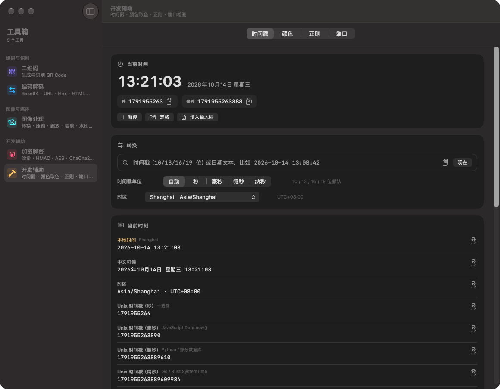

## 当前工具

### Git 助手

只做普通用户用得上的两件事：

- **一键克隆**：粘贴仓库地址（GitHub / Gitee / 任何 Git 服务；`https://`、`git@`、网页地址都认）→ 选个存放位置 → 开始。实时日志与进度条，完成后一键在访达中打开。默认浅克隆（只下最新版本，快得多），想留完整历史可以取消勾选。从网页复制地址（带 `?tab=...` 尾巴、带引号、裸域名）都能解析。
- **一键推送**：选个文件夹（支持拖拽）→ 自动读出分支、改动明细、最近提交 → 写一句说明 → 推送。`git add -A + commit + push` 一条龙；没配过名字邮箱会先引导填一次；远程有新提交时会提示"先拉取再推"，一键搞定；文件夹还不是 Git 仓库时可以就地初始化并配远程。
- **账号与密钥**（折叠卡片，克隆公开仓库用不上）：SSH 密钥一键生成 / 复制公钥 / 直达平台的 SSH 设置页 / 测试连通；或者平台访问令牌（GitHub PAT / Gitee 私人令牌），存进系统钥匙串，通过 `GIT_ASKPASS` 环境变量在运行时注入——不写进 remote 配置、不出现在命令行参数里。

认证策略：远程是 SSH 形式就直接用本机密钥（零配置）；HTTPS 形式且对应平台存了令牌就自动带上；都没有时给出明确的人话指引。所有 git 报错都翻译成中文白话（连不上 / 密钥没被认可 / 推送被拒 / 仓库不存在……）。

### SSH 密钥

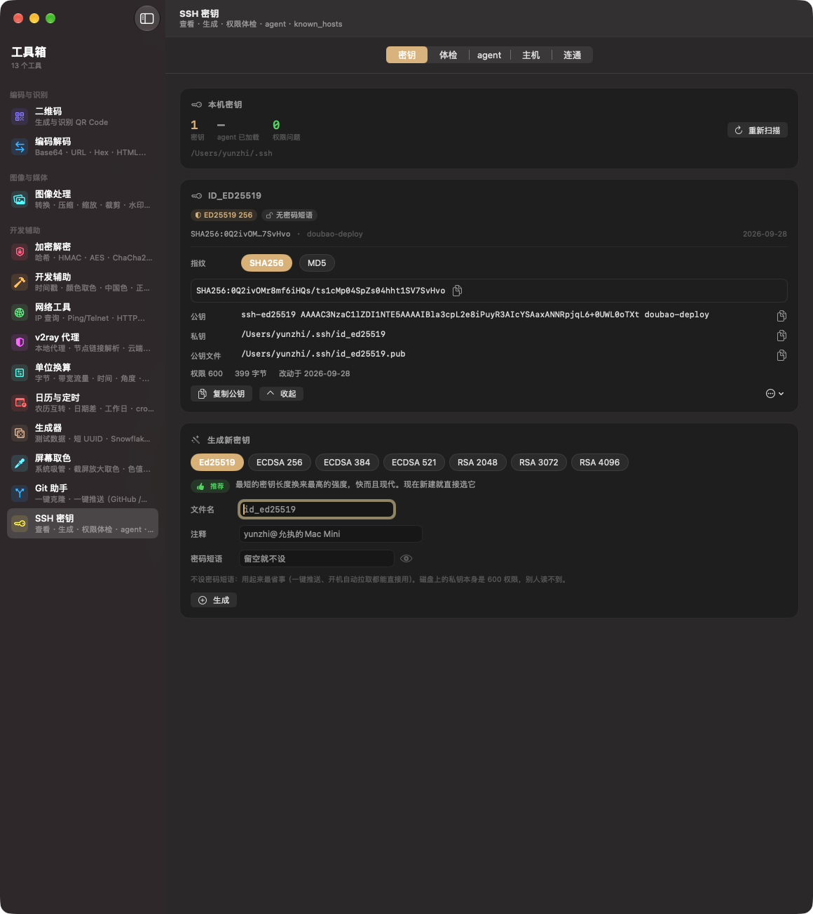

独立的密钥管理器，五个子页面；Git 助手里的密钥功能与它共用同一份引擎实现：

- **密钥**：扫描 `~/.ssh` 全部密钥（类型、位长、SHA256 / MD5 指纹自算——known_hosts 里几百条也能一次算完、注释、创建时间、权限、私钥有没有密码短语）；详情展开看公钥全文和路径；`.pub` 丢了可以从私钥一键补出来；删除走废纸篓（`FileManager.trashItem`，不走 Finder——那条路需要「自动化」授权，没授权会静默挂住）；生成支持 Ed25519 / ECDSA 三档 / RSA 三档，可选密码短语（留空给出取舍说明），生成后一键复制公钥、直达各平台 SSH 设置页
- **体检**：`~/.ssh` 目录、每把私钥、公钥、config、authorized_keys、known_hosts 的权限逐项检查——权限太开 ssh 会报 "Permissions 0644 … are too open" 还拒绝使用；一键修复
- **agent**：ssh-agent 状态、已加载的钥匙（指纹 + 注释）、点 chips 加载/卸下、全部加载/卸下；有密码短语的密钥支持 `--apple-use-keychain` 存进钥匙串
- **主机**：known_hosts 逐条解析（主机名、算法、指纹、哈希条目、@cert-authority 标记），按名字或指纹过滤，「忘掉这个主机」就是服务器重建后处理 "REMOTE HOST IDENTIFICATION HAS CHANGED" 的标准操作（`ssh-keygen -R` 自带 .old 备份）；`~/.ssh/config` 解析成 Host 块（HostName / User / Port / IdentityFile / ProxyJump），孤儿 IdentityFile（指向不存在的文件）标红；authorized_keys 列出「谁能登进本机」
- **连通**：真实 `ssh -T -v` 探测（GitHub / Gitee / GitLab / Bitbucket / 自定义 host:port），可指定只试某一把钥匙（`IdentitiesOnly`）；解析 verbose 输出得出平台认可了哪把钥匙、客户端试过哪些、平台账号是谁；完整握手输出可展开

测试台本 108/108：指纹与系统 `ssh-keygen -lf` 对拍一致、RSA 位长靠解析公钥二进制算出、生成各算法、权限体检与修复、known_hosts / config / authorized_keys 解析、密码短语检测（用 `SSH_ASKPASS_REQUIRE=force` 塞一个必败的 askpass，让 `ssh-keygen` 立刻报错而不是挂在 `/dev/tty` 上等输入）。

### 提示词（模板库 + 压缩 + 扩写）

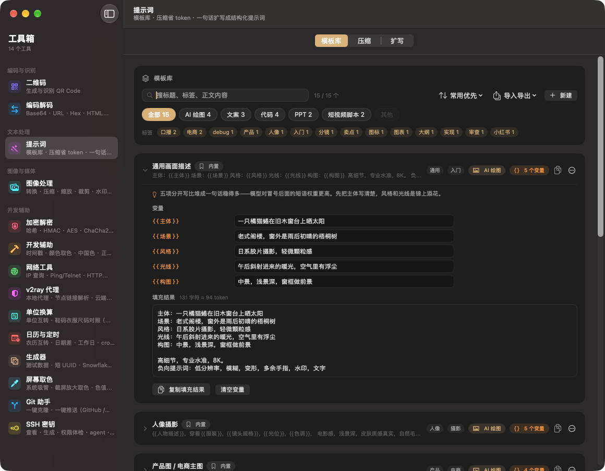

独立的「AI 创作」分组（和原型助手一组）。三段各管一件事：把常用写法存下来、把啰嗦的删掉、把太短的补起来。

- **模板库**：本地存模板（JSON 持久化），按 AI 绘图 / 文案 / 代码 / PPT / 短视频脚本 / 其他分类，15 个内置示例（代码审查的三档分级、文案的「给两个别人想不到的细节」这类关键约束都写在模板里）。正文里写 `{{变量}}` 自动生成对应输入框，填完实时出填充预览（带字符 / token 数），一键复制发给 AI；未填的变量保留占位符并提示还剩几个
- 标签检索：搜索在标题 / 标签 / 正文 / 说明里一起找，多关键词是 AND；标签云点一下即筛选；排序有常用优先 / 最近修改 / 标题；填过的变量值也持久化，切走再回来不用重填
- **导入导出**：JSON 文件（完整导出 / 裸数组 / 单个模板三种形态都能读，秒级时间戳的旧文件也认），按「标题 + 分类」去重合并并汇报导入几个跳过几个；另可导出成 Markdown 清单直接分享；内置模板改乱了一键恢复
- **压缩**：规则式精简——礼貌套话与致谢、语气垫词（「其实」「基本上」）、冗长表达（「进行优化」→「优化」「由于这个原因」→「因此」）、重复内容、空白与标点，五大类可单独开关；命中明细逐条列出；实时显示字符数 / token 数削减
- 压缩有**保护区**：代码块、行内代码、各种引号里的内容、`{{变量}}` 整段原样保留，表格行不参与判重——那些地方的字面内容本身就是指令的一部分。规则跑到收敛为止，压两遍和压一遍结果相同；「大概」「请务必」这类有真实语义的词不删
- **扩写**：一句话 → 结构化专业提示词，五种骨架（绘图 / 文案 / 代码 / PPT / 短视频脚本）。绘图走中英对照词库：按主体类别（人物 / 动物 / 食物 / 产品 / 风景 / 抽象）补细节，风格 / 光线 / 构图 / 色彩 / 画质分档补全，画幅转成 `--ar`，负向提示词可开关；文案 / 代码 / PPT / 视频按成熟骨架出结构，平台、受众、语言这类线索词能从输入里认出来，认不出的明确列成「必须你自己定」清单
- 扩写默认是**本地规则式**（套骨架 + 词库补细节），不调用大模型——界面明说，不装作会算命

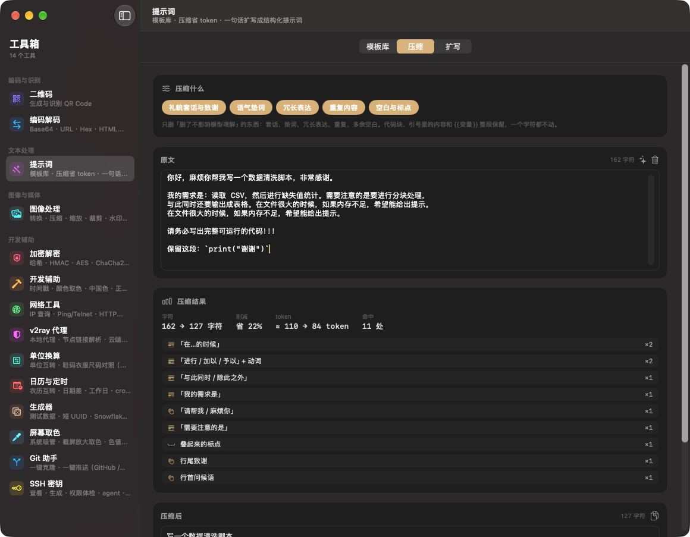

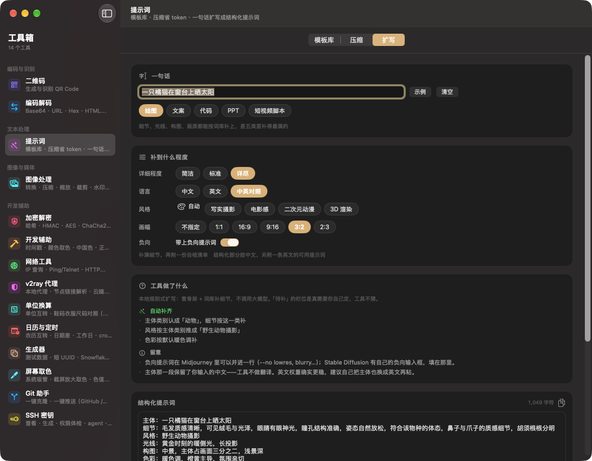

### AI 驱动（提示词 + 原型助手共用）

「AI 创作」分组里的提示词与原型助手都带一个全局 **AI 驱动开关**：关 = 本地规则生成（零联网、零花费）；开 = 结果由大模型生成，每个面板出一个「AI 生成」按钮，出错时自动回退本地规则结果。

- 厂商与模型：内置 6 家 OpenAI 兼容厂商（DeepSeek / Kimi / 硅基流动 / OpenRouter / 智谱 / PPIO），每家带预置模型列表，也支持手输模型 ID；列表可能过时，以官方文档为准
- **key 复用「API 余额」工具的钥匙串**（同一 service），填一次就够；没填 key 时配置卡明说去哪填，生成时会拦下并给出指引
- 指令不是裸发：压缩把保护区规则写进 system；扩写把目标类型 / 详细程度 / 语言 / 画幅翻译成结构要求；原型四段把章节骨架、页面区域划分、组件组成、Mermaid 形状与转义规则一并带上——模型照着钉死的骨架输出，不是自由发挥
- 开关是全局的：在任何工具里改，其他工具即时生效

### 原型助手（需求 / 页面 / 组件 / 流程图）

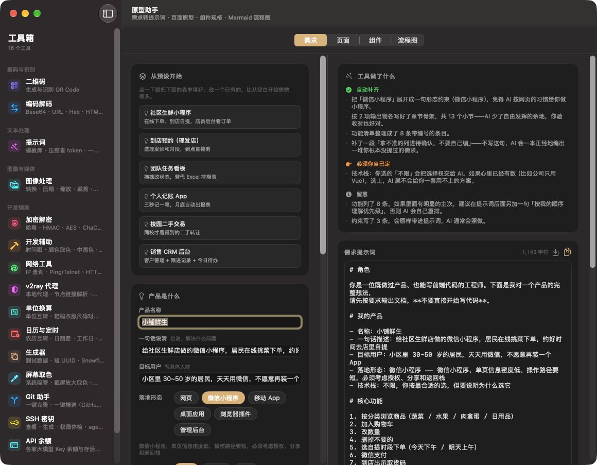

给「会用 AI 但不会写需求」的人用的：把脑子里的想法翻译成 AI 能准确接住的文字。四段串起一条完整路径（想法 → 需求 → 页面 → 组件 / 流程），每一段的产物都是一段可以直接粘给 AI 的文字。

- **需求**：填产品名称、一句话描述、目标用户、功能和约束，勾选要 AI 交付什么（PRD / 页面原型 / 数据模型 / 低代码配置 / 任务拆分），提示词里会**钉死每个输出物的章节骨架**让 AI 逐节输出——少了自由发挥的余地，漏哪节一眼能看出来；并强制要求「拿不准的列进待确认，不要自己编」
- **页面**：一句「这页要干什么」→ 自上而下的文字原型。区域骨架按页面类型（首页 / 列表 / 详情 / 表单 / 看板等 10 类）自动带出，字段写成表格，勾选的状态（加载 / 空 / 出错 / 断网 / 无权限等 6 种）各带一句「该怎么表现」，末尾附这类页面最容易做砸的几条
- **组件**：按钮 / 弹窗 / 表单 / 表格等 14 类组件的规格提示词——组成部分自动补全（比如按钮的加载态、防重复提交），变体（尺寸 / 语气 / 深色模式等 8 种）展开成具体要求，无障碍与验收要点可开关；属性留空时会让 AI 先提一版等你确认，而不是替你编
- **流程图**：节点卡片式编辑（六种形状、判断节点的「不成立时去哪」分支、「流程到此结束」标记、上下移动排序），实时出 Mermaid 代码；节点 id 与文字脱钩（N1/N2…），特殊字符自动用引号包裹并把引号转成 `#quot;`；另附走向示意预览、校验提醒（判断断链 / 分支悬空 / 死循环 / 是否同目标）、保存 `.mmd`、导出双击即看的 HTML 预览
- **20 个内置预设**：需求 6（社区生鲜 / 到店预约 / 任务看板 / 记账 / 校园二手 / CRM 后台）、页面 6（商品列表 / 详情 / 报销表单 / 看板 / 登录 / 个人中心）、组件 5（主按钮 / 确认弹窗 / 登录表单 / 数据表格 / 图片上传）、流程 3（登录 / 下单支付 / 请假审批），都是按真实产品写的完整内容，点一下套用再改

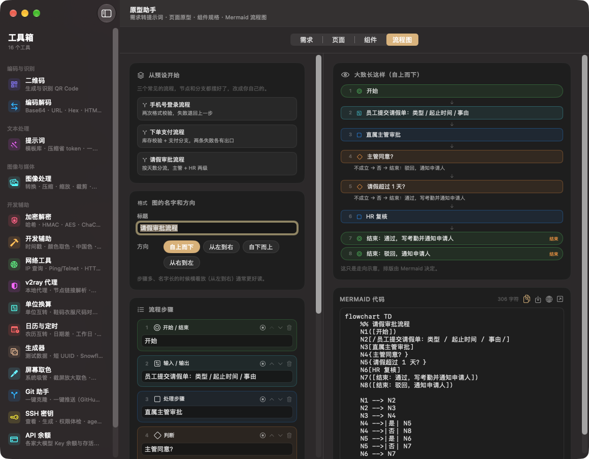

### API 余额（大模型 Key 余额与存活检测）

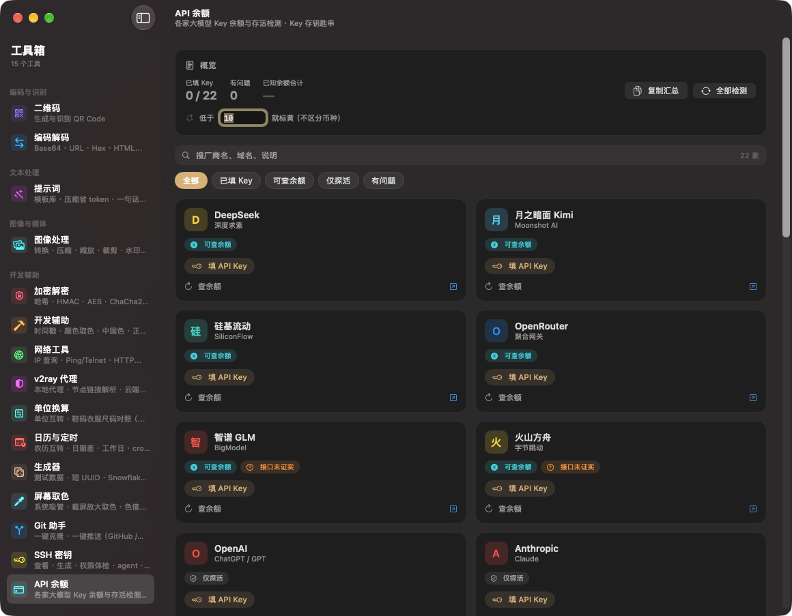

填入各家大模型平台的 API Key，一键查余额。设计立场是**能查的查，不能查的说清楚**——各家的开放程度差得远，硬凑一个统一的「余额」数字只会骗人。

- **可查余额**（6 家）：DeepSeek（`/user/balance`，官方文档核对过字段）、月之暗面 Kimi、硅基流动、OpenRouter，以及路径**未经证实**的智谱 GLM 和火山方舟（这两家的网关在路由之前就统一返回 401，真路径和瞎编的路径响应一模一样，没法证实——界面上如实标了「接口未证实」）
- **仅探活**（16 家）：OpenAI 早就下线了 credit_grants；阿里云 / 腾讯云 / 百度云的余额在**云账户**层面，要用 AK/SK 签名才拿得到，跟 API Key 是两回事。这些只发一个免费的 `/models` 请求确认 key 还有效；OpenRouter 之外的公开探活端点（如 PPIO）会明确说「没能验证 Key」而不是假装验过了
- **自定义厂商**：自建中转站 / 公司网关自己填地址，返回的金额字段自动识别（含 `hard_limit_usd` 这类带币种后缀的命名）；内置 one-api / new-api 模板（quota ÷ 500000 换算成美元，支持 `New-Api-User` 额外头）
- **Key 只进 macOS 钥匙串**，一个字节都不写 UserDefaults，界面只显示掩码；本机 / 内网地址的报错不会让你去开代理
- 打开时自动检测已填 Key 的厂商（可关，一次会话只测一遍）；批量检测限并发 4 条；余额低于阈值标黄、归零标红，不同币种分开合计不加总
- 每张卡能展开**原始返回**：全部字段按路径列出（金额字段高亮）+ 美化后的 JSON，方便排查自定义端点到底回了什么

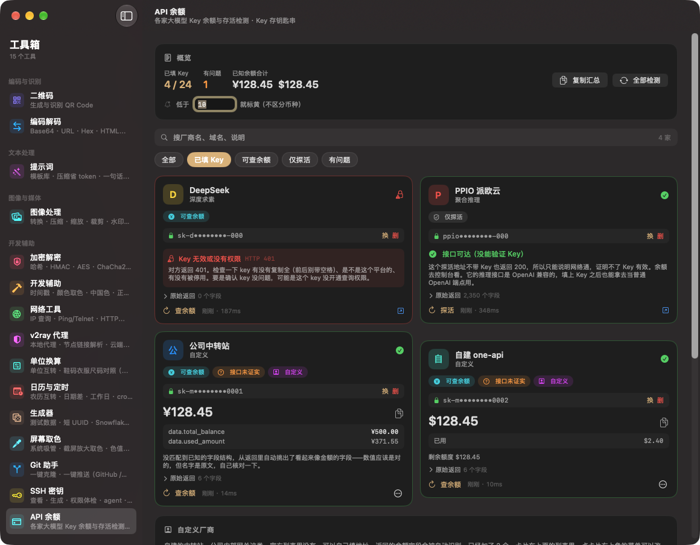

### 单位换算（14 类）+ 尺码换算

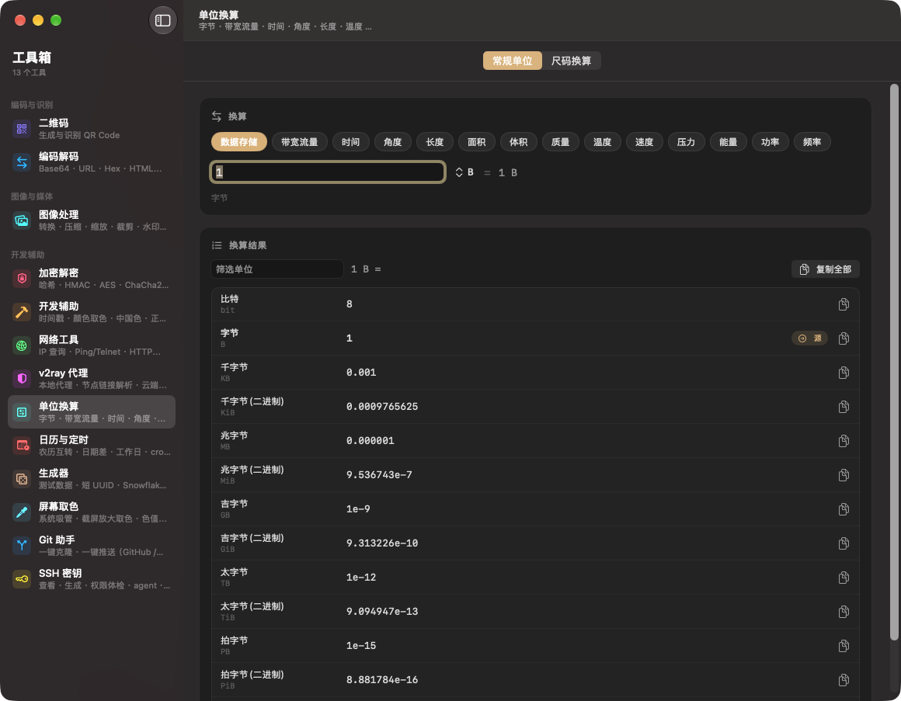

- **14 个类别**：数据存储（KB/KiB/MB/MiB… 十进制与二进制分开列）、带宽流量（bps/Mbps/MB/s…）、时间、角度、长度（含市制/海里/光年/秒差距）、面积（含亩/公顷/英亩）、体积（美英加仑/桶/汤匙）、质量（含斤两钱/克拉）、温度（°C/°F/K/°R/°Ré，带零点的线性换算）、速度（含节/马赫/光速）、压力、能量、功率、频率
- 一个值进去出一张全单位对照表；基准 / 源单位带标记，单位可搜索过滤
- 输入框直接写 `3.5GB`、`100 Mbps`、`180°` 会自动切到对应类别和单位（`B` 与 `b`、`L` 与 `l` 按大小写区分）
- 超大 / 超小数值自动转科学计数法；一键复制全部

**尺码换算**（切到顶部「尺码换算」）：鞋码、衣服尺码，欧码 / 美码 / 国内码互相对照。

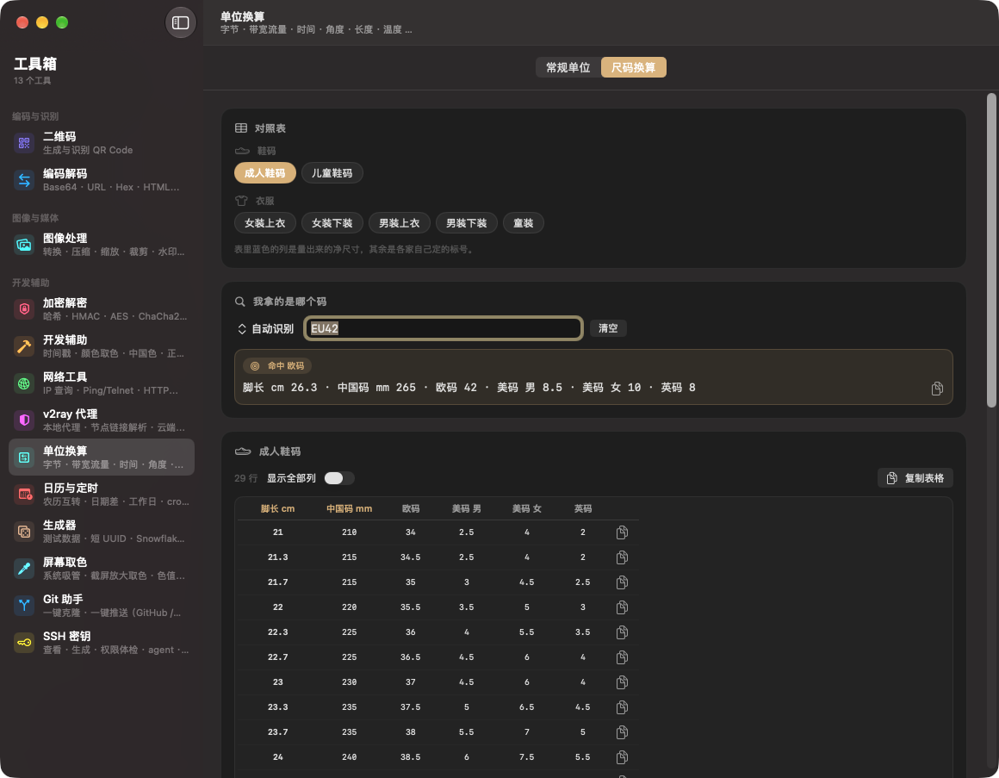

- **7 张表**：成人鞋码（欧 34–48，每半码一行）、儿童鞋码（欧 20–34，含青少年码 1Y/2Y 与参考年龄）、女装上衣 / 女装下装 / 男装上衣 / 男装下装、童装（按身高）
- **立场是「先量身体，再对表」**：每张表都以量出来的净尺寸当轴心列（脚长 cm / 净胸围 / 净腰围 / 身高），表头蓝色列就是它，其余是各家标号。标号是约定，净尺寸才是跨体系唯一能对齐的东西
- **查这个码**：填哪个体系的码都行——`42`、`EU42`、`欧码42`、`8.5`（美码男）、`265`（中国码 mm）、`26.5cm`、`W30`、`165/88A` 都认；也可以指定体系避免歧义（同一数字在鞋的男女码里就不是一回事）。认不出时给出写法示例
- 鞋码按公式生成（欧码 = 1.5×脚长 + 2.5 巴黎点，美码英码大麦粒，中国码 = 脚长毫米数），逐行对得上真实鞋标；衣服表手工落表，靠 13 条内部恒等式互验（女装 欧码 = 净胸围/2 − 6、男装 美码 = 欧码 − 10、法码 = 欧码 + 2、意码 = 欧码 + 4……）
- 命中行在表里高亮并自动滚动到位；每行可单独复制，整表可复制为制表符分隔文本（直接贴进 Excel / Numbers）
- 每张表带**怎么量**（软尺手法、什么时间量）和**注意事项**（国内标码普遍比国际码大一档、同一双脚女鞋比男鞋大 1.5 号、国产鞋和欧洲品牌同一脚长差一码这类最容易踩的坑）

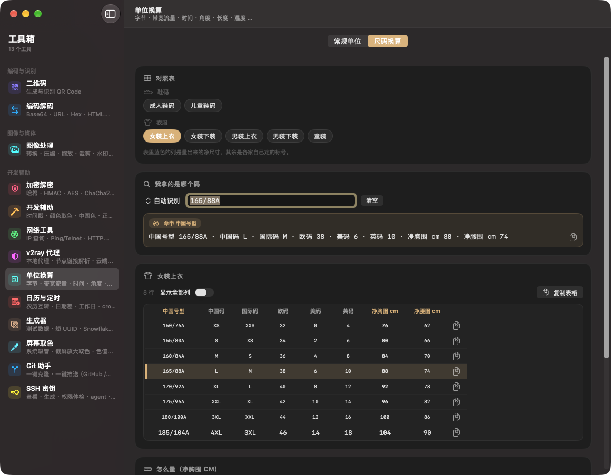

### 日历与定时（3 合 1）

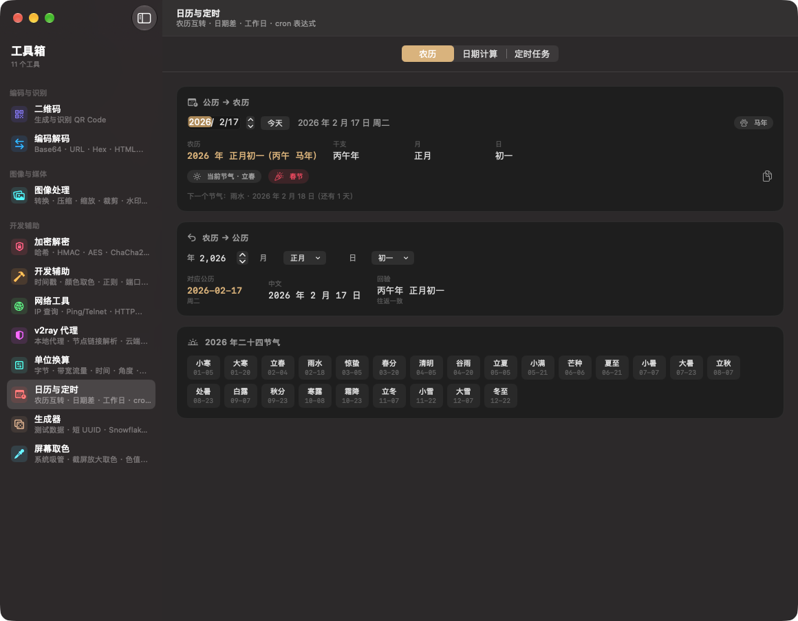

- **农历**：公历 ↔ 农历互转（1900–2100，含闰月、干支、生肖），公历→农历带当日节气、节日与下一节气倒计时；农历→公历支持选闰月、当月天数联动、往返回验；全年二十四节气表一键回填
- **日期计算**：日期差（总天数 / 满年满月分解 / 周 / 小时，区间内工作日与休息日数）；日期加减（年 / 月 / 天，月末加月自动落到该月最后一天）；工作日计算（第 N 个工作日，跳过自定义周末 + 自定义放假日 / 调休上班日——法定假日每年都变，不内置，自己贴）
- **定时任务**：cron 表达式解析（5 段标准 + 6 段带秒 + `@daily` 等 7 个宏 + 月份 / 星期英文名 + `*/n`、区间、列表 + Quartz 扩展 `L` / `L-n` / `LW` / `nW` / `5L` / `3#2` / `?`），中文描述 + 字段逐项拆解 + 未来 6 次执行时间（带相对倒计时、时区可切换）；逐字段可视化编辑（每段独立输入框 + 快捷值 + 错误红标定位到段）；14 个常用模板；按周期反向生成；本机 crontab 只读查看（macOS 日 / 周同时限定时的"或"语义也按 Vixie cron 处理；不存在日期如 2 月 30 日会明确判"当月永不触发"）

### 生成器（测试数据 + ID + 记忆密码）

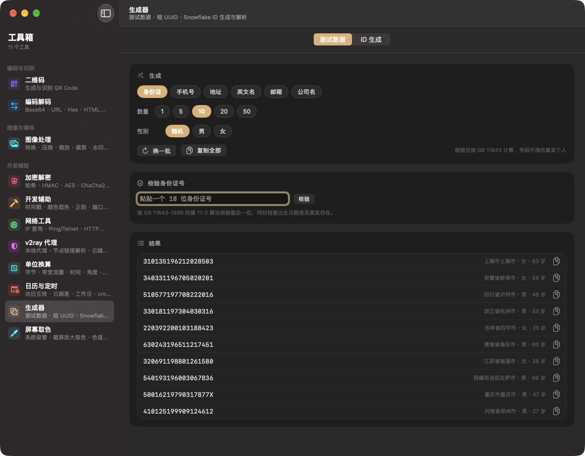

- **测试数据**（仅供开发测试，不指向真实个人）：身份证（真实省市地址码 + GB 11643 模 11-2 校验位，可指定性别，带校验器）、手机号（真实号段，可指定移动 / 联通 / 电信 / 广电）、地址（真实省市 + 随机路名门牌）、英文名（男 / 女名表）、邮箱、英文公司名；批量生成自动去重
- **短 ID**：UUID v4 / 去横线 / 128 位压 Base62（定长 22）/ NanoID / Base62 / Base36 / 纯数字 / 邀请码风格（去掉 0/O/1/I/L 易混字符），长度可调
- **Snowflake ID**：生成（Twitter / Discord / 百度 / Unix 纪元预设，机器位 / 序列位 / 机器号 / 纪元可配，同一毫秒内序列自增、时钟回拨保单调）；解析（二进制位段可视化 + 时间 / 机器 / 序列还原 + 配置自洽性检查）
- **UUID**：RFC 4122 / 9562 全部版本——v1（时间戳 + MAC 节点，可用本机网卡或随机节点，回拨换 clock_seq、同刻保单调）、v6（v1 重排）、v7（Unix 毫秒 + 毫秒内计数保有序）、v3 / v5（命名空间 + 名称，DNS/URL/OID/X500 预设）、v4；批量生成去重有序；解析任意 UUID：版本 / 变体 / 时间戳（三种历元）逐字段拆表 + 格式对照（带横线 / 去横线 / URN / 基大整数）
- **记忆密码**：给生活用的短语密码，不是开发随机串——中文常用词 512 个（每条带拼音，拼音本身就是一份 ASCII 备用词表，网站不收中文时切过去念着还是那个词）或英文短词 1567 个；抽词不放回（同一条里不出现重复词，熵按 log2(N×(N-1)×…) 精确算）；词数 / 分隔符 / 首字母大写 / 末尾数字符号可调；强度按真实攻击成本给三档估算（在线限速 1e3/s、拖库慢哈希 1e4/s、GPU 硬打 1e11/s）并按等级给适用场景建议；「强」的门槛定在 70 bit——三种攻击都过 100 年线。纯数字密码单列一页：避开全同 / 连号 / 重复段，并明确讲清「有错误锁定 6 位够用、没锁定再多位也不安全」的使用边界。生成的密码只在内存里，绝不落盘

### 鼠标连点（连点器 + 键盘连发）

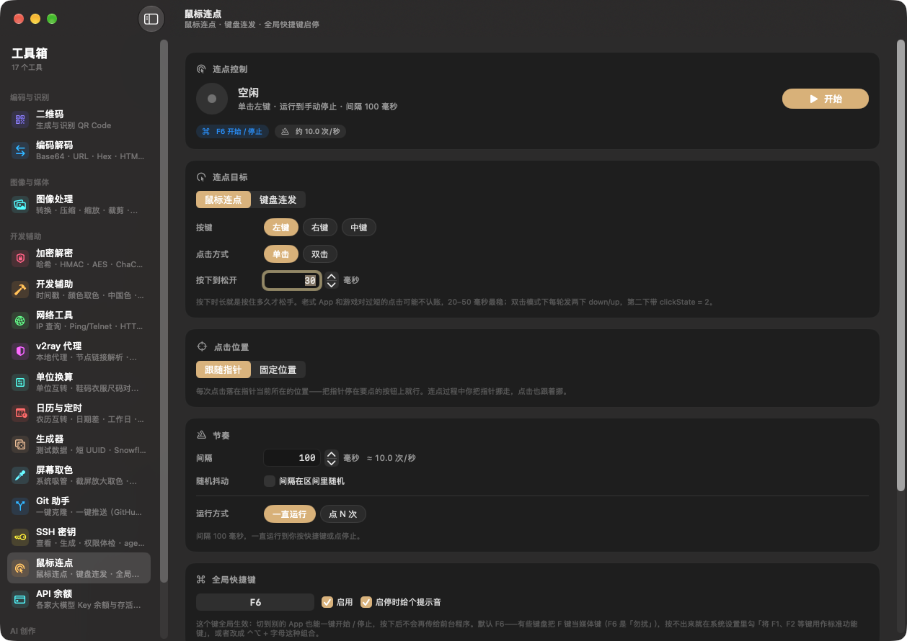

- **鼠标连点**：左 / 右 / 中键，单击或双击（第二下带标准 clickState，不会被认成两下单击）；间隔 10 毫秒起、可加随机抖动；次数可以一直跑，也可以指定 N 次后自动停
- **点击位置**：跟随指针（把指针停在按钮上就行）或固定坐标（每次点击前把指针挪过去；也可以关掉移动指针，只把事件发到那个坐标）。取位置有两个办法：点按钮后有 3 秒倒计时，把指针移到目标点等它自动记；或者直接按拾取热键（默认 F7），按一下记当前位置——不用再把鼠标挪回按钮上
- **键盘连发**：任意组合键都认（⌘⌃⌥⇧ + 字母、F1–F20、方向键、小键盘），间隔与次数同上；「按住不放」模式按下后一直保持，直到你停——适合持续移动、持续施法这类场景
- **全局快捷键**：开始 / 停止默认 F6、拾取位置默认 F7，切到别的 App 也能用，按下后不会再传给前台程序；两条都可以录制成任意组合（要求带修饰键或用功能键，免得吃掉正常打字）；托盘菜单里也能启停
- **权限**：走 CGEvent 合成真实事件，第一次用要先去「辅助功能」授权——没授权时事件是**静默失败**的，所以界面会在开始前直接拦下并给出跳转按钮；App 重新构建过之后可能要重新勾一次
- 按下时长可调（老式 App 和游戏对过短的点击不认账，20–50 毫秒最稳）；运行中实时显示已点次数与运行时长；「按住不放」在停止或退出 App 时会自动把手松开

### 屏幕取色

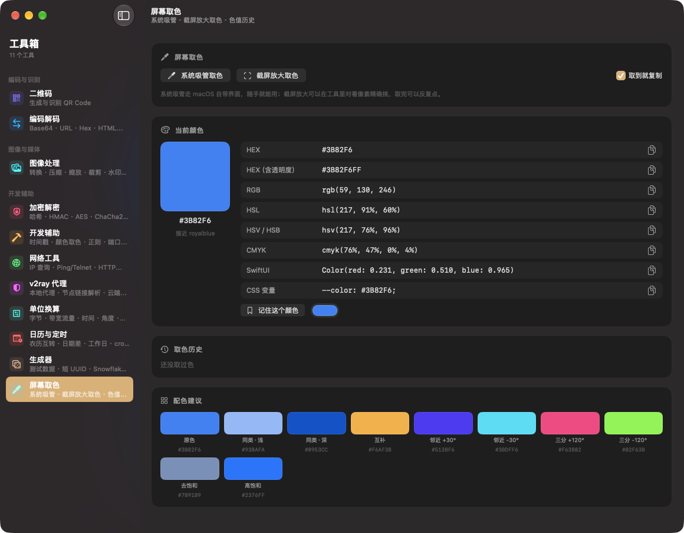

- **系统吸管**：走 macOS 自带 NSColorSampler，带放大镜像素网格，零权限随手用
- **截屏放大取色**：ScreenCaptureKit 截主屏（`CGDisplayCreateImage` 在 macOS 15 已废弃），画布上鼠标悬停出 15×15 像素放大镜 + 实时 HEX + 屏幕坐标，点击取色可反复点；无屏幕录制权限时给出一键授权引导
- 取到即复制（可关）、取色历史色板（24 个）、8 种格式色值（HEX/带透明度/RGB/HSL/HSV/CMYK/SwiftUI/CSS 变量）、命名色提示与配色建议

### v2ray 代理

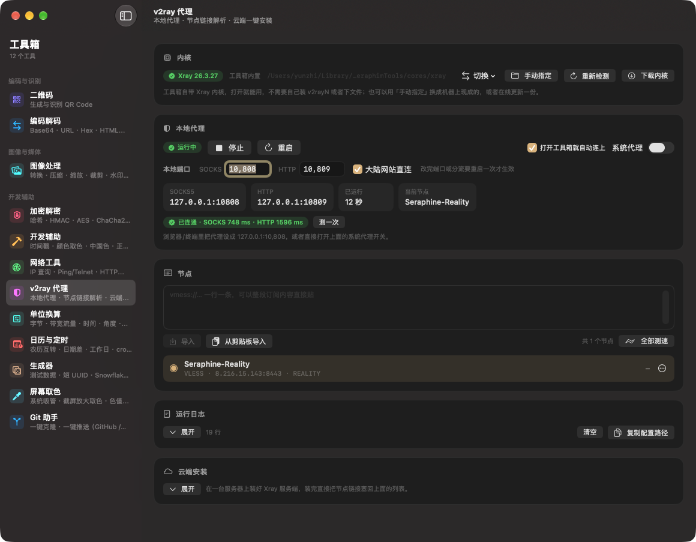

- **内置内核**：App 自带 Xray（macOS arm64，含 geosite.dat 分流数据，打包在 Resources 里），第一次用自动释放到 Application Support 并清隔离标记——用户不用装 v2rayN，也不用自己下内核；也支持复用本机 v2rayN 的内核、手动指定路径，或在线更新（GitHub 直连不通时自动走 gh-proxy 等镜像）
- **本地代理**：粘贴 `vmess:// vless:// trojan:// ss:// socks://` 分享链接批量导入（去重、往返导出），一键起停内核，本地同时开 SOCKS5 + HTTP 两个入站端口；可勾选「打开工具箱就自动连上」；可选大陆网站直连，缺 geosite.dat 自动降级全局并提示
- **连通性自检**：内核起来后自动拿本地代理真实请求一次（SOCKS 与 HTTP 两个端口并发探测），把「已连通 · SOCKS xxx ms · HTTP xxx ms」直接摆在界面上——端口在监听不代表真能出去，这一步专门防"显示运行中实际连不上"
- **分流修复**：国内 DNS 会把国外域名污染成中国 IP，用 `geoip:cn` 反查会把该走代理的流量判成直连（实测 www.gstatic.com 被解析到广东电信的 IP）；同时 `geosite:cn` 里混着 Google 的国内 CDN 域名（www.gstatic.com / fonts.gstatic.com），只按它放行会让 Google 页面加载不出资源。现在的做法：先按 `geosite:geolocation-!cn`（墙外域名）走代理，剩下的再按 `geosite:cn` 直连，`domainStrategy` 用 `AsIs` 不做 DNS 反查
- **系统代理**：一键把 macOS 全部网络服务的 HTTP/HTTPS/SOCKS 代理指到本地端口并排除本地地址；关闭或退出 App 时按快照完整还原（备份的是开启前的状态，快照前会先抹掉指向本机端口的残留，避免把上次自己留下的状态当成用户的原始设置存进去）；端口重复（SOCKS = HTTP）会在启动前拦下并提示
- **停止保障**：停止时先还原系统代理再停内核（顺序反了会有一段"代理指着死端口"的断网窗口）；还原后还会再扫一遍，只要有服务仍指向本机端口一律关掉；内核意外崩溃时自动关掉系统代理，不把网留在半路上
- **残留自愈**：打开页面时跟系统实际状态对一次账——发现"系统代理还指着本机端口、内核却不在了"（强杀 / 崩溃 / 上次还原失败留下的现场）就自动清理并提示，历史脏备份也会顺手洗干净
- **节点测速**：TCP 握手延迟（非阻塞 connect + poll 精确计时），单个或全部并发
- **云端安装**：折叠卡片（默认收起）；SSH 直连（密钥 BatchMode / 密码走系统自带 expect），先探活检查架构与 root，再从镜像下载内核安装到服务器、写 systemd 服务、放行防火墙端口，REALITY 密钥对用本机内核 `xray x25519` 生成；装完自动把节点链接回填到本地列表；支持 VLESS+REALITY（默认）/ VLESS+WS / VMess+WS 三种服务端形态
- **退出保护**：App 退出时自动还原系统代理并停掉内核，不留断网现场

### 网络工具（6 合 1）

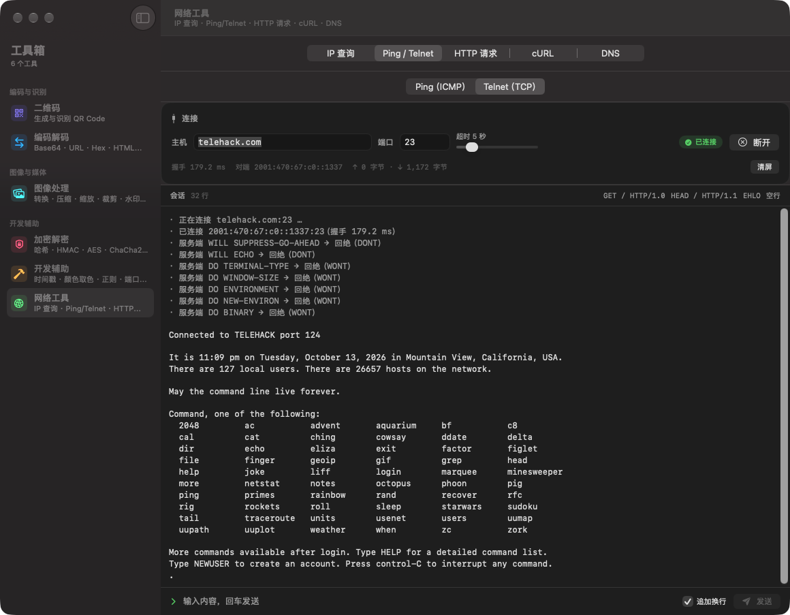

- **IP 查询**：本机公网 IP（v4 / v6）与 IP 归属地两用；6 个查询接口（ipip.net / ip-api.com / icanhazip v4+v6 / ipapi.is / ipinfo.io）可勾选，TaskGroup 并发流式返回、谁先回来先显示，单接口失败不影响其他；汇总卡片提取公网 v4/v6、归属地、运营商、ASN
- **Ping / Telnet**：Ping 调系统 `/sbin/ping(-6)`（非 root 可用），流式解析逐包延迟、TTL/hlim，延迟条形图 + min/avg/max/丢包统计，支持次数/间隔/包长/超时与持续模式；Telnet 是裸 TCP 终端——非阻塞 socket + poll 可控超时，自动处理 telnet IAC 选项协商（WILL→DONT、DO→WONT、子协商跳过），ANSI 转义清洗，UTF-8 失败退 GB18030，握手耗时与收发字节统计，GET/HEAD/EHLO 快捷指令
- **HTTP 请求**：GET/POST/PUT/PATCH/DELETE/HEAD/OPTIONS；请求头编辑器、5 种请求体（无 / JSON / 表单 urlencoded / 原始文本 / multipart 文件上传）；响应卡片带状态、体积、耗时分解（DNS / TCP / TLS / 发送 / 等待 / 接收，基于 URLSessionTaskMetrics）、重定向链、响应头；JSON 按键顺序保序美化；响应体按 charset 解码，非 UTF-8 退 GB18030；请求历史；一键复制为 cURL；自签证书放行开关
- **cURL**：表单 → 命令（多行 / 单行 / 精简三种风格，shell 引号安全转义，JSON 自动补 Content-Type、Bearer 自动补 Authorization 头）；命令 → 表单反解析（自实现 shell 分词，认 `-X/-H/-d/--data-urlencode/-F/-u/-b/-A/-e` 和 `-sLk` 连写，认不出的参数列出来不乱猜，带 `-d` 没写 `-X` 推断 POST 并提示）
- **DNS 查询**：调 `/usr/bin/dig`；A/AAAA/CNAME/MX/NS/TXT/SOA/SRV/CAA/PTR/ANY，自选服务器、TCP / DNSSEC / 递归追踪；结果分应答/权威/附加三段展示，附 dig 原始输出；NXDOMAIN / SERVFAIL 等状态给白话解释；本机 DNS 配置读取（scutil --dns + /etc/hosts）
- **Webhook 接收器**：一键在本机起一个临时 HTTP 端点（NWListener，回环监听不出网），什么路径什么方法都收；请求头 / 查询串 / body 全记录，body 自动体检（JSON 保序美化、表单百分号解码、XML / HTML / 文本 / 二进制 hex），最新请求自动展开；可配置回给调用方的状态码与响应体；按路径 / 请求头 / body 内容过滤；一键复制 curl 重放命令；可选 App 启动自动恢复接收、请求到达提示音

ATS 已在 Info.plist 声明 `NSAllowsArbitraryLoads`（本地 HTTP 与非标准端口需要）。

### 开发辅助（5 合 1）

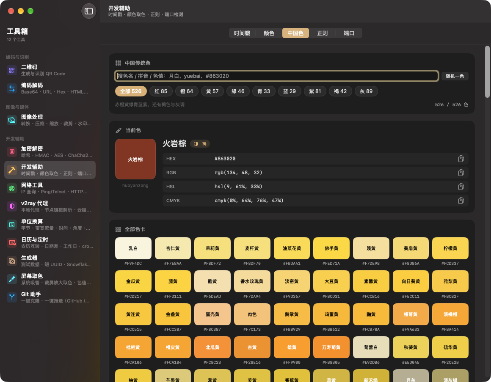

- **时间戳**：实时时钟（秒/毫秒一键复制、暂停/定格）；智能输入框——纯数字按位数特征识别秒/毫秒/微秒/纳秒，日期文本支持 25 种格式（ISO 8601 / RFC 2822 / 中文 / 斜杠 / 紧凑数字 / 仅时间补今天），21 种时区，14 城市时区对照（标注跨日）；时间差计算（人类可读 + 天/时/分/秒/毫秒分解）
- **颜色**：吃下 `#RGB/#RRGGBB/#RRGGBBAA`、`rgb()/rgba()/hsl()/hsv()`、CSS 命名色（148 个）、中文名、裸三元组、`0x` 前缀；14 种格式输出（HEX/RGB/HSL/HSV/CMYK/SwiftUI/NSColor/UIColor/Android/Flutter/Java/CSS 变量）；屏幕吸管（NSColorSampler）与图片取色（拖入图片、鼠标扫过实时显示该像素色值、点击取走）；WCAG 对比度体检（黑/白底、AA/AAA 判定、自动推荐前景色）；配色建议（互补/三分/邻近/明暗阶梯）与最近用色调色板；提示最接近的 CSS 命名色与中国传统色
- **中国色**：zhongguose.com 收录的 526 个中国传统色（乳白、月白、天青、火岩棕……）；九大色系筛选（红/橙/黄/绿/青/蓝/紫/褐/灰，色名自带"棕""紫""白"等字时优先按名字归类）；搜索支持色名 / 拼音 / HEX 前缀；点色卡即复制 HEX，详情卡给出 HEX/RGB/HSL/CMYK 与复制按钮；输入任意色值自动反查最接近的传统色（RGB 距离 + 色相差打分，网格直接摆出前 16 个）；右键菜单可复制色名/HEX/RGB/CMYK；「随机一色」从当前范围抽一个
- **正则**：实时高亮匹配（命中段着色）、分组捕获表（含命名分组解析）、替换预览（`$1` `$<name>` `\1` 都认，可限量替换）；30 个常用模板（网络/数字/文本/中国常用/日志代码，每个带示例一键填入）；语法速查点击插入
- **端口**：TCP 探测用非阻塞 connect + poll，超时与并发可调；端口输入支持逗号/范围/中文分隔符，6 组预设（常用/Web/数据库/远程运维/消息队列/游戏）；结果区分开放/关闭/超时/失败，开放端口带握手耗时和服务名；本机监听端口一键读取（基于 lsof，打开页面自动读），可一键填入端口框

### 加密解密（6 合 1）

- **摘要（单向）**：MD5 / SHA-1 / SHA-256 / SHA-384 / SHA-512 / CRC32，十六进制与 Base64 双输出；支持 HMAC（MD5/SHA 家族）；文本实时计算，也支持整个文件算摘要（拖放 / 选择器，大文件后台读取）；弱算法（MD5 / SHA-1）界面标红提醒
- **校验和（CRC）**：CRC-8 / CRC-16 / CRC-32 / CRC-64 四个家族共 34 个参数化模型（Modbus、CCITT、X-25、USB、Castagnoli、MPEG-2、cksum、XZ 等常见协议变体都在），六个参数（多项式 / 初值 / 输入输出反射 / 结果异或 / 标准校验值）全部摆开可对照；自定义模式可以改任意参数或从已有模型「改一份」；结果给十六进制 / 十进制 / 大端小端字节序列；贴上协议文档给的已知值实时核对（字节序写反了也能认出来）；文件走流式分块计算，几 GB 也不爆内存；34 个模型的标准 check 值与 Python zlib / binascii 独立实现全部对拍一致
- **对称加密（双向）**：AES-256-GCM / AES-256-CBC / ChaCha20-Poly1305；口令经 PBKDF2-SHA256（10 万轮 + 随机盐）派生密钥，或直接填 32 字节原始密钥（hex / Base64）；密文自带信封格式 `STM1.<算法>.<盐>.<载荷>`，解密时自动识别算法和密钥来源，跨设备粘贴即可解；认证算法（GCM / ChaCha20）篡改一个字节都解不开
- **古典密码（双向）**：凯撒（带 25 种位移暴力破解表）、ROT13（自逆）、维吉尼亚、XOR（hex / Base64 / 文本输出，解密自动认格式）、摩斯电码
- **随机生成**：UUID v4 批量、随机密码（长度 / 字符集 / 排除易混淆字符，实时显示熵和强度）、随机密钥 / 字节（系统加密随机源）
- **JWT**：解析（header / payload / 签名三段、声明逐项解读、`exp/nbf/iat` 时间体检——字符串数字不会误判成日期）、验签（HS 全家族 + RS / PS / ES 全家族，公钥 / 证书 / 裸 base64 都认，与 openssl 完全互认）、签发（密钥文本 / base64 / hex 三种写法，非对称支持 PKCS#8 / PKCS#1 私钥，可现场生成密钥对，iat / exp 一键刷新）；`alg: none` 与两段 token 给出安全提醒

单向的摘要没有"解密"按钮——哈希本来就不该可逆。

### 编码解码（10 种算法 + 字符集转换）

- **编解码**：Base64（标准 / URL-safe / 无填充 / 换行）、URL 百分号编码（严格 / 宽松 / `+` 视空格）、十六进制（大小写 / 0x 前缀 / 分隔符 / 换行）、Base32（RFC 4648）、二进制 / 八进制 / 十进制字节、HTML 实体（150+ 命名实体 + 数字实体）、Unicode 转义（`\uXXXX` / `\u{…}` / `\U…` / `\x…`，代理对自动合并，Windows 路径不误伤）、JSON 字符串转义
- 全部实时双向转换，方向一键切换 / 交换，每个算法带一键示例
- 解码很宽容：Base64 自动去前缀 / 空白 / 引号并补 padding；hex 自动吃掉 `0x` 和分隔符；解码出的字节不是 UTF-8 时按 GB18030 兜底
- **字符集转换**：UTF-8 / UTF-16(LE/BE) / UTF-32 / ASCII / Latin-1 / Windows-1252 / GB18030(GBK) / Big5 / Shift-JIS / EUC-KR / Mac Roman 互转，附 hex dump 字节视图——专治各种乱码回不去

### 图像处理（6 合 1）

- **格式转换**：PNG / JPEG / HEIC / TIFF / GIF / BMP，质量可调，透明区域自动垫色，实时显示体积对比（按文件头嗅探原格式，不信扩展名）
- **压缩**：按质量 或 按目标大小（二分搜索最接近目标体积的质量），可选限制长边，压缩率可视化
- **尺寸缩放**：宽高联动（可锁定比例）、百分比 / 长边预设、三种插值算法、"不放大"保护
- **裁剪**：交互式画布（框内拖动平移 / 四角等比 / 四边单边），9 种比例锁定，三分线参考，精确像素数值输入
- **水印**：文字或图片水印，九宫格定位或全图平铺，旋转 / 不透明度 / 阴影，默认字号随图片宽度自适应
- **Base64 互转**：图片 → Base64（Data URL 前缀、76 字符换行）；Base64 → 图片（宽容解码：自动去前缀/空白/引号，兼容 URL-safe 变体，自动补 padding，按魔数识别格式）

所有子功能共享同一张"当前图片"，支持拖放、剪贴板、Finder 双击（已在 Info.plist 声明图像文件类型）。

### 二维码（生成 + 识别）

**生成**
- 实时预览，输入即变
- 纠错等级 L / M / Q / H
- 输出尺寸 128–2048 px，整数倍像素放大，边缘无毛边
- 静默区（quiet zone）可调 0–12 码点
- 自定义前景/背景色、透明背景
- 快捷模板：网址 / 纯文本 / Wi-Fi / 名片(vCard) / 邮件 / 电话 / 短信 / 地理位置
- 导出：拷贝图像、PNG、SVG 矢量（路径按行程合并，文件小）
- 显示实际像素尺寸和码点规格（如 735×735 px · 27×27 码点）

**识别**
- 摄像头实时扫码（节流 4 fps，命中即停提示、去重、提示音）
- 图片文件（拖放 / 选择器），识别结果带序号标注框
- 剪贴板：图片、纯文本链接直接识别
- 可选同时识别一维码（EAN / Code128 / PDF417 等，基于 Vision）
- 结果分类（链接 / Wi-Fi / 名片 / 邮件…），可展开、复制、直接打开链接

## 构建

```bash
./build.sh            # Debug 构建并启动
./build.sh Release    # Release 构建
./build.sh Debug --no-launch
```

或者直接用 Xcode 打开 `SeraphimTools.xcodeproj`，选中 SeraphimTools scheme，⌘R。

## 添加新工具

1. 在 `SeraphimTools/Tools/` 下建目录，写你的 View。
2. 打开 `SeraphimTools/Core/ToolCatalog.swift`，在 `all` 数组里加一行：

```swift
ToolItem(
    id: "my-tool",
    title: "新工具",
    summary: "一句话说明",
    systemImage: "wrench.and.screwdriver",
    tint: .blue,
    category: .dev,          // 分类（不够就往 ToolCategory 加 case）
    content: { MyToolView() }
),
```

侧边栏、导航、详情页标题全部自动生成。需要新分类就往 `ToolCategory` 加 case。

## 工程说明

```
SeraphimTools/
├── App/            # @main 入口、侧边栏外壳
├── Core/           # ToolCatalog 工具注册表（加工具就改这里）、AppState
├── Shared/         # 通用组件（卡片、Toast、TextPane 文本面板、ImageCodec）
└── Tools/
    ├── QRCode/     # 二维码工具
    ├── ImageKit/   # 图像处理（模型/引擎/六个子页面）
    ├── Codec/      # 编码解码（模型/引擎/HTML 实体表/界面/字符集转换）
    ├── Crypto/     # 加密解密（模型/引擎/六个子页面，含 JWT 与 CRC 校验和）
    ├── DevKit/     # 开发辅助（时间戳/颜色/中国色/正则/端口，引擎 + 界面 + 模板库）
    ├── NetKit/     # 网络工具（IP 查询/Ping/Telnet/HTTP/cURL/DNS/Webhook 接收器，引擎 + 六个子页面）
    ├── V2Ray/      # v2ray 代理（节点解析/config 生成/内核管理/进程/系统代理/SSH 云端安装）
    ├── Units/      # 单位换算（14 类单位表 + 智能输入解析；尺码换算：SizeEngine 模型 + 7 张对照表）
    ├── Prompt/     # 提示词（模板模型与变量引擎/规则式压缩器/骨架与词库扩写器/内置模板/三段界面）
    ├── Balance/    # API 余额（22 家厂商表/解析引擎与通用深扫/钥匙串存取/厂商卡网格）
    ├── Prototype/  # 原型助手（四段表单模型/需求·页面·组件三个提示词引擎/Mermaid 生成与校验/20 个预设/左右分栏界面）
    ├── Calendar/   # 日历与定时（农历数据表/节气/日期计算/cron 解析与本机 crontab）
    ├── Generator/  # 生成器（测试数据/短 ID/雪花 ID 生成与解析/记忆密码：短语 + 数字 PIN）
    ├── Picker/     # 屏幕取色（ScreenCaptureKit 截屏 + 放大镜 + 吸管）
    ├── GitPal/     # Git 助手（仓库地址解析/命令流式封装/状态解析/钥匙串令牌/SSH 适配层）
    └── SSHKey/     # SSH 密钥（引擎 + 五个子页面；Git 助手的密钥功能复用这份引擎）
Support/Info.plist   # App 的 Info.plist（含图像文件类型声明、摄像头权限）
tools/apply_icon.swift # 从 title_icon_tools.png 重切 AppIcon（含圆角透明遮罩）；tools/make_icon.swift 为早期代码画图标的备用脚本
```

**引擎测试**：编解码、加密（含 JWT 与 CRC 校验和）、开发辅助、网络、v2ray、新四件（单位换算 / 日历定时 / 生成器）这些引擎都是纯函数（或仅依赖系统命令），可以脱离 UI 单独测。用 `swiftc` 把对应引擎文件和一个测试 `main.swift` 编在一起即可（哈希用 RFC / FIPS 标准向量，Base32 是 RFC 4648 向量，对称加密做加解密往返 + 篡改检测；JWT 做 RFC 7515 官方向量 + openssl 双向对拍；CRC 对全部 34 个模型验标准 check 值（对 "123456789" 的公认结果）、逐位实现与查表实现互验、增量分块与整块互验，再用 Python zlib / binascii / 手写实现做跨语言对拍；时间戳做单位换算/时区跨日/格式解析，颜色做色彩空间往返/WCAG 对比度已知值，正则做分组/替换/零宽不死循环，端口用临时监听 socket 验证开放与关闭探测；网络块用本地回显服务器验证 HTTP 收发/重定向/耗时分解、ping 与 dig 输出解析、IAC 协商、curl 往返与 shell 分词；v2ray 块覆盖 6 种协议链接解析/往返、8 种协议组合的 config 被真实内核 `-test` 认可、geo 缺失降级、端到端起代理后 curl 走 SOCKS/HTTP 入站访问真实网站、停止后端口释放；新四件块覆盖单位换算往返与已知值（含温度零点）、身份证校验位与号段、雪花位段往返与 2 万连发单调性、11 个已知春节日期、2 万日期公历农历往返、节气已知日期、cron 下次执行与错误处理；记忆密码块覆盖词表完整性（中英无重复、拼音无撞车）、熵精确值、同种子可复现、3.5 万次抽样卡方均匀性检验、PIN 弱模式过滤与破解时间各量级断言；尺码块覆盖表结构完整性（每格有值、轴心严格递增、欧码无重复）、鞋码公式对照 15 个真实鞋标锚点（容差半码、要求 ≥10/11 完全吻合、脚长最大偏差 ≤1cm）、服装表 13 条内部恒等式、号型数字与净尺寸列自洽、查询语义（EU42 / 欧码42 / 265mm / 26.3cm / W30 / 165/88A / M / 净尺寸就近落档）与空输入乱码兜底；提示词块覆盖变量解析（顺序去重 / 空格 / 嵌套花括号）、填充（未填保留占位）、Codable 与导入导出三种形态往返、去重合并统计、检索排序、压缩每条规则与保护区（代码块 / 引号 / 变量 / 表格行）、幂等性（压两遍 = 压一遍）、分组存储键往返、扩写五种骨架与中英词库与确定性；余额块覆盖 22 家厂商表完整性（id 唯一、链接合法、能力与端点匹配、证实程度标注）、按 key 前缀猜厂商（长前缀必须赢过 `sk-`）、各具名解析器对官方文档示例、one-api 的 quota 换算、通用深扫与兄弟字段币种推断、`hard_limit_usd` 命名、NSNumber 把数字 0/1 桥接成布尔的坑、金额格式化（千分位 / 小额四位 / 负数）、key 掩码、请求头文本往返、端点拼装（相对 / 完整 / query 鉴权）、HTTP 状态与欠费措辞识别、探活语义、超深嵌套与超长响应兜底；原型块覆盖枚举完整性与 ASCII 存储键、顿号并列短语的智能拆分（完整句子不拆）、三个文本引擎的关键章节与防编造要求、字段表格与列表两种形态、Mermaid 六种形状 / 特殊字符引号转义 / 判断分支与终止节点 / 换行 br、校验（断链 / 悬空 / 自指 / 是否同目标 / 节点过载）、HTML 导出与转义、20 个预设全量跑引擎无警告；Git 块覆盖仓库地址四种形态解析与互转（含带端口/网页尾巴/scp 假端口）、porcelain v2 状态解析、报错翻译、本地起 git daemon 真实跑通克隆→提交→推送→再克隆验证内容落地→拉取→落后被拒→拉后重推、钥匙串存取、askpass 脚本行为、SSH 公钥指纹）。最近一次：加密 CRC 207/207 + 跨语言对拍 7/7、JWT 69/69 + openssl 对拍 39/39、SSH 密钥 108/108（指纹与 ssh-keygen -lf 对拍）、记忆密码 136/136、尺码 585/585、提示词 221/221、余额 197/197、原型助手 497/497（另有真实端点冒烟：9 家用无效 key 走完整请求链，401/404/200 与文案全部对上）、开发辅助 147/147、网络 197/197、v2ray 152/152 + 端到端 10/10、新四件 289/289、Git 169/169 + 端到端 75/75 通过。

**一个值得留意的编译器坑**：Xcode 27 的 swiftc 在 ViewBuilder 嵌套过深时会触发编译器断言崩溃（`Querying VarDecl's type before type-checking parent stmt`），报错只有 crash 堆栈没有具体行号。解法是把巨大的 `body` 拆成小的子 View / 子函数（开发辅助的颜色取色画布就踩过）。

**App 特性**：记住上次打开的工具和子页面（@AppStorage）；支持从 Finder / `open` 命令打开图片并自动切到图像工具。

**一个重要的本机构建注记**：`project.pbxproj` 里给 Swift 编译加了 `OTHER_SWIFT_FLAGS = -disable-sandbox`。原因是本机 Xcode 27 的 swift-plugin-server 在套沙箱时会报 `sandbox_apply: Operation not permitted`，导致 `@State` 等 SwiftUI 宏展开失败。如果以后换了机器编译出现 `SwiftUIMacros.StateMacro could not be found` 的报错，就是这个开关被删了或环境变了。

**摄像头权限**：用途声明在 `Support/Info.plist` 的 `NSCameraUsageDescription`。首次使用摄像头需在「系统设置 → 隐私与安全性 → 摄像头」放行。
